<div align="center">

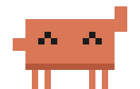

# P.E.T.

### **P**equeno **E**xplorador de **T**elas

**O Clawd, o caranguejinho do Claude Code, e a turma dele morando na sua barra de tarefas
(e passeando em cima das suas janelas).**

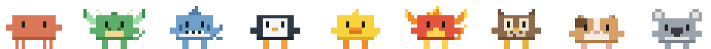

Um tamagotchi de desktop que come os seus prompts, comemora quando a task termina,
cai duro quando os testes quebram e acena quando o Claude precisa de você.


[Instalar](#-instalar) · [Usar](#-usar) · [Janelas](#-andando-nas-janelas) · [Tamagotchi](#-tamagotchi) · [Pets](#-pets) · [Clima](#-clima) · [Claude Code](#-integração-com-o-claude-code) · [Sprites](#-sprites-próprios) · [Estrutura](#-estrutura)

</div>

<p align="center">
  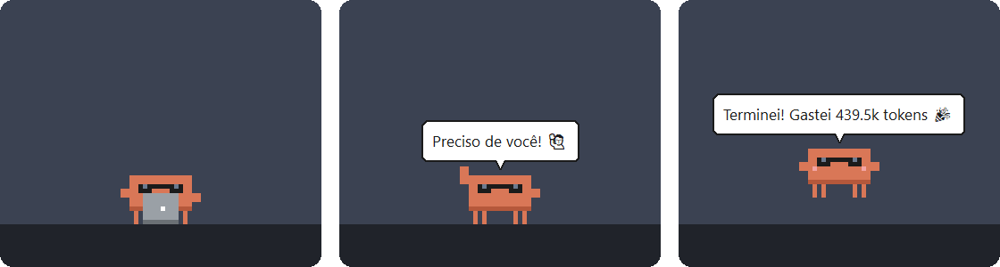
</p>

## ✨ O que ele faz

- 🦀 **Vive na tela:** anda sobre a barra de tarefas, vira nas bordas, e dá pra pegar, arremessar e chacoalhar (ele fica tonto).
- 🪟 **Explora as janelas:** pousa e passeia em cima das janelas abertas, pula de uma pra outra e pega carona quando você
  arrasta a janela.
- 🍖 **É um tamagotchi:** tem fome, energia, felicidade e sujeira, sente o tempo com o PC desligado, pega gripe e evolui de ovo até Clawd ancião.
- 🤖 **Conversa com o Claude Code:** reage aos seus prompts, ao fim de cada task, a testes passando ou falhando e a comandos com erro.
- 📊 **Conta tokens:** da sessão, da task e dos últimos 7 dias, com meta semanal.
- 🌦️ **Sente o tempo lá fora:** se veste conforme o clima de verdade da sua cidade, se esconde na trovoada e
  avisa de manhã se vai chover.
- ⏰ **Lembra você das coisas:** escreva o quê e quando (*"amanhã 9h"*, *"daqui a 20 min"*) e na hora ele
  acena com um balão e um alarminho até você ver.
- 🌙 **Tem rotina:** te manda dormir na hora que você escolher, comemora Natal, Páscoa e o seu aniversário,
  dança quando tem música tocando e some quando você abre um jogo em tela cheia.
- 🛍️ **Loja:** gaste XP em acessórios (coroa, boné, laço...) sem perder evolução.
- 🐉 **Nove pets:** Clawd, dragãozinho, tubarãozinho, pinguinzinho, patinho de borracha, fênix, corujinha,
  porquinho-da-índia e coala, cada um com o próprio progresso e o próprio jeito.
- 🖥️ **Se vira em vários monitores** e lembra onde você o deixou.
- 🪶 **Leve:** Python puro com tkinter, sem nada pra instalar pelo `pip`.

## 🚀 Instalar

1. Instale o **Python 3.10 ou mais novo** pelo [python.org](https://www.python.org/downloads/windows/), deixando
   marcada a opção *tcl/tk and IDLE* (já vem marcada).
2. Baixe o projeto:
   ```powershell
   git clone https://github.com/LeoMagaMoraes/desktop-pet.git
   cd desktop-pet
   ```
3. Crie o atalho **Pet** na área de trabalho:
   ```powershell
   python criar_atalho.py                 # use --menu-iniciar pra pôr no Menu Iniciar também
   ```
4. Ligue a integração com o Claude Code (opcional, mas é a parte mais legal):
   ```powershell
   python instalar_hooks.py
   ```

Pronto: dois cliques no atalho **Pet** e ele aparece em cima da barra de tarefas.

<details>
<summary>Outras formas de abrir</summary>

```powershell
python main.py                          # com terminal (mostra erros)
pythonw pet.pyw                         # sem terminal
python main.py --demo                   # passa por todas as animações, sem salvar nada
python main.py --demo --fase anciao     # demo de uma fase: ovo, filhote, clawd ou anciao
python main.py --demo --pet fenix       # demo de outro pet (dragao, tubarao, pinguim, pato, fenix, coruja, porquinho, coala)
```

Só abre um pet por vez. Pra fechar: clique direito → **Sair**.
</details>

## 🖱️ Usar

| Ação | O que acontece |
|---|---|
| **Clique** | Carinho: um coração sobe, ganha felicidade e XP, e ele diz a temperatura lá fora. Se estiver dormindo, acorda. Se estiver tocando um lembrete, é o *"ok, vi"* |
| **Clique direito** | Abre o menu |
| **Arrastar** | Ele fica pendurado balançando as perninhas e cai com gravidade ao soltar |
| **Arrastar e soltar rápido** | Sai voando e quica nas bordas da tela |
| **Chacoalhar** | Fica tonto, com estrelinhas, e perde um pouco de felicidade |
| **Esfregar o mouse em cima** | Banho: tira a sujeira e solta bolhas de sabão |
| **Soltar em outro monitor** | Passa a morar naquele monitor |
| **Soltar em cima de uma janela** | Pousa na borda dela e passeia por lá |
| **Menu → Brincar** | Cai uma bola ⚽: ele corre atrás e chuta (veja abaixo) |

<table>
  <tr>
    <td align="center">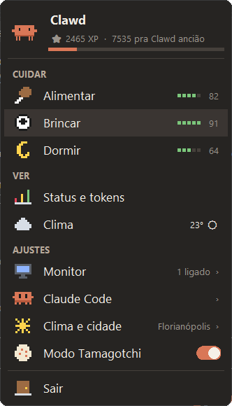</td>
    <td align="center">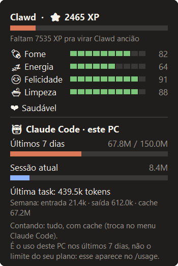</td>
  </tr>
  <tr>
    <td align="center"><b>Menu</b><br><sub>barrinhas dos status, chaves liga/desliga e páginas pra Monitor e Claude Code</sub></td>
    <td align="center"><b>Status e tokens</b><br><sub>fase, XP, necessidades e o uso do Claude Code neste PC</sub></td>
  </tr>
</table>

## 🪟 Andando nas janelas

Além da barra de tarefas, a **borda de cima de cada janela aberta** vira chão.

- **Solte o pet em cima de uma janela** e ele pousa nela em vez de cair até a barra.
- **De vez em quando ele pula sozinho** pra cima de uma janela que esteja ao alcance (*"Hup! 🦘"*), e de uma
  janela pra outra.
- **Na beirada**, ele geralmente dá meia-volta; às vezes pula pra baixo.
- **Carona:** arraste a janela e ele vai junto.
- Se a janela **fecha, minimiza ou outra janela tapa** o lugar onde ele está, ele cai até o próximo chão.
- Só conta a parte da borda que está **visível**: se outra janela está na frente, ali não dá pra pisar.
  Janelas maximizadas também não servem (não sobra espaço em cima).
- Não gostou? Menu → **AJUSTES** → desligue **Andar nas janelas** (se ele estiver em cima de uma, ele desce).

## ⏰ Lembretes

Menu → **VER** → **Lembretes** → **Novo lembrete**. Escreva *o que* lembrar e *quando*; embaixo aparece como ele
entendeu (*"→ sexta (06/11) às 14:00"*), pra não ter surpresa.

| Você escreve | Ele entende |
|---|---|
| `15:30`, `15h`, `às 15`, `meio-dia` | hoje nesse horário (ou amanhã, se já passou) |
| `daqui a 20 min`, `em 2 horas`, `em 1h30` | contando a partir de agora |
| `amanhã 9h`, `depois de amanhã às 14`, `hoje 18:00` | o dia e a hora (sem hora: 9h) |
| `sexta 14h`, `segunda às 8` | o próximo dia com esse nome |
| `25/12 8h`, `5/1/2027 9:15` | a data (sem ano: a próxima vez que ela chegar) |
| `todo dia 9h` | todo dia, nesse horário |

Na hora, o pet **acorda se estiver dormindo, acena sem parar** com o balão *"⏰ Lembrete: ..."* e toca um alarminho
(se os sons estiverem ligados).

- **Clique nele** pra dizer que viu (*"Beleza! ✅"*).
- Ou abra o menu: aparecem **Feito!** e **Me lembra em 10 min** no topo.
- **PC desligado na hora marcada?** Quando ele abrir, avisa assim mesmo, dizendo pra quando era.
- A página **Lembretes** lista os próximos; clicar num deles apaga.

## ⚽ Brincar de bola

Menu → **CUIDAR** → **Brincar**: cai uma bola de praia do alto e o pet corre atrás dela e chuta.

- A bola tem **a mesma física do pet quando você joga ele**: gravidade, quique nas bordas da tela, atrito no
  chão e pouso em cima das janelas.
- Ele **corre** (bem mais rápido que andando). Se a bola cai lá embaixo, ele pula da janela; se ela para em
  cima de uma janela ao alcance, ele pula até lá. Se ficar alta demais, ele desiste (*"A bola ficou lá em cima!"*).
- **Você também brinca:** clique na bola pra dar um toquinho, ou pegue e arremesse com o mouse.
- Depois de uns chutes (4 a 7) ele cansa, a bola some e ele comemora. Cada chute dá XP e felicidade.
- Lembrete tocando, o Claude chamando ou tela cheia encerram o jogo na hora.

## 🌙 Rotina, festas e música

<p align="center">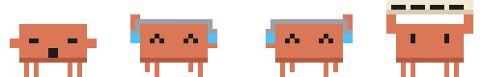</p>

Tudo em menu → **AJUSTES** → **Rotina e datas**.

- **Hora de dormir:** escolha um horário (ex.: `23:00`). Passou dele, ele boceja e te manda ir dormir a cada
  20 minutos; se você sair do PC, ele dorme também. Até as 5h ainda conta como "depois da hora".
- **Datas especiais:** gorro no **Natal**, chapéu de festa e confete no **Ano Novo** e no **Carnaval**, chapéu de
  bruxa no **Halloween**, orelhas de coelho na **Páscoa** e um parabéns no **Dia do Programador** (dia 256 do ano).
  Cadastre o **seu aniversário** e ele faz festa com confete e canta parabéns.
- **Música:** quando sai som do PC por alguns segundos seguidos, ele põe o fone 🎧, solta notinhas e dança.
  O volume vem direto do Windows, sem instalar nada; bipes e notificações curtas não contam.
- **Tela cheia:** abriu um jogo, filme ou apresentação em tela cheia no monitor dele, ele some e volta quando
  você sair. Lembrete tocando faz ele aparecer mesmo assim.
- **Resumo do dia:** às 18h (ou quando quiser, em menu → **VER** → **Resumo do dia**) ele conta o seu dia: tempo no
  PC, tasks e tokens do Claude Code, testes, projetos e quantos carinhos e comidas ele ganhou.

<p align="center">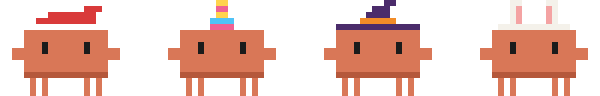</p>

## 🛍️ Loja

<p align="center">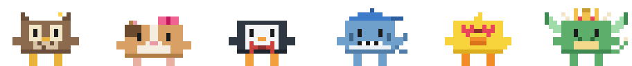</p>

Menu → **VER** → **Loja**. Gaste XP em acessórios: flor, laço, gravata-borboleta, boné, óculos de coração e coroa.

- **Comprar não tira evolução:** o XP total continua (é ele que decide a fase); o gasto fica separado.
- **O guarda-roupa é de todos os pets**, mas quem paga é o pet que está na tela.
- Um item por lugar (cabeça, rosto, pescoço). Clique de novo pra tirar; pôr de volta é de graça.
- Roupa de festa e do clima ganham do chapéu da loja enquanto valem (no Natal é gorro, na chuva é guarda-chuva).

## 🥚 Tamagotchi

<p align="center">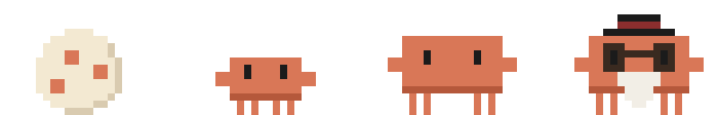</p>

| Fase | XP | Como é |
|---|---|---|
| Ovo | 0 | Não anda nem come. Faz carinho que ele choca em uns 17 minutos |
| Filhote | 100 | Pequenininho, já come, brinca e reage ao Claude Code |
| Clawd | 1.000 | O caranguejinho de sempre |
| Clawd ancião | 10.000 | De cartola, óculos e barba |

O XP vem de carinho, comida, brincadeira, banho, remédio, testes passando, tasks do Claude Code
e de 1 XP por minuto com você no PC.

**Necessidades** (0 a 100, 100 = ótimo). Quando alguma fica baixa ele avisa com um balão 🍖 💤 😢 🪰 🤒.

| | Acordado | Dormindo | PC desligado |
|---|---|---|---|
| Fome | −6/h | −3/h | −2/h |
| Energia | −7/h | +40/h | recupera (dorme) |
| Felicidade | −2/h (−6/h se você sumir do PC) | igual | −2/h |
| Sujeira | +5/h | +2/h | +1/h |

- **Sono:** com a energia abaixo de 15 ele cochila sozinho e acorda quando ela chega em 95.
- **Gripe:** 2 horas seguidas com fome abaixo de 20 deixam ele espirrando. Só cura com **Dar remédio**.
- **Banho:** com sujeira acima de 55 aparecem mosquinhas. Esfregue o mouse nele até ouvir "Cheirosinho!".
- **Tempo fora:** ao abrir, ele desconta o tempo desde a última vez (até 30 dias) e conta quanto tempo ficou sozinho.

> [!TIP]
> Não quer cuidar de ninguém hoje? Desligue o **Modo Tamagotchi** no menu: os status ficam pausados
> (nem o tempo com o PC desligado conta), sem avisos nem gripe. Ele continua passeando e ganhando XP.

## 🐉 Pets

Menu → **Trocar de pet**. Além do Clawd 🦀, tem mais oito, cada um com o seu jeito:

| Fases | Pet | Como é | Jeito |
|---|---|---|---|
| 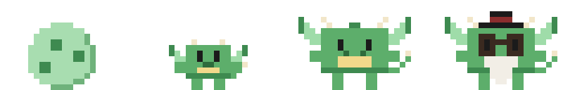 | **Dragãozinho** 🐉 | Verde, asinhas que batem quando ele levanta os braços, chifres, crista e cauda com espinho | Espirra faísca 🔥 |
| 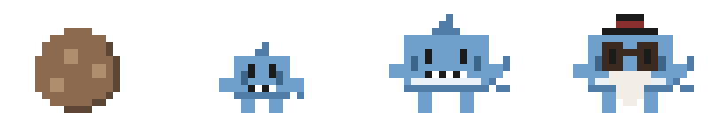 | **Tubarãozinho** 🦈 | Azul de barriga branca, sorriso de dentinhos, barbatana, cauda em meia-lua e guelras | Nasce de uma cápsula marrom (a "bolsa de sereia", como muitos tubarões de verdade). Espirra bolhas 💦. Escondido na trovoada, só a barbatana fica de fora |
| 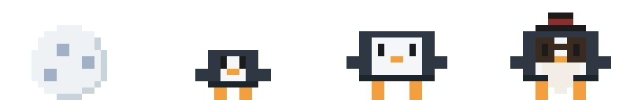 | **Pinguinzinho** 🐧 | Preto de rosto e barriga brancos, bico e pezinhos laranja | **Ama frio:** abaixo de 15 °C fica feliz em vez de sentir fome e dispensa o agasalho. Acima de 25 °C cansa mais e já liga o ventilador. Espirra floco de neve ❄ |
| 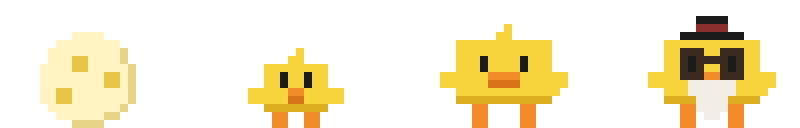 | **Patinho de borracha** 🦆 | Amarelo, bicão laranja e topetinho | O pato do *rubber duck debugging*: quando um comando falha, pergunta **"Já explicou o problema pra mim? Linha por linha"**. Faz quack no carinho |
| 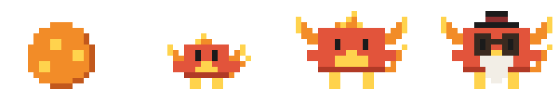 | **Fênix** 🔥 | Vermelha com peito dourado, asas, crista e cauda de fogo | **Renasce:** se a felicidade zerar, vira cinzas, volta pro ovo e renasce na hora, sem perder o XP. Anciã (a fase máxima), ganha a opção **Renascer** no menu: volta como ovo e começa tudo de novo (o XP zera, o número de renascimentos fica). Espirra faísca |
| 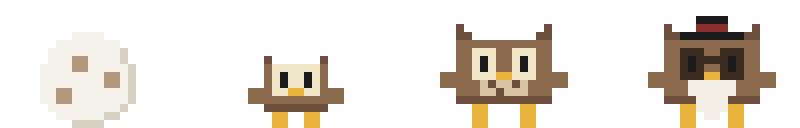 | **Corujinha** 🦉 | Marrom, discos claros nos olhos, orelhinhas de pena e peito pintadinho | **Noturna:** de dia cochila de pijama e cansa rápido; de noite fica esperta, alegre e gasta pouca energia. Espirra pena 🪶 |
| 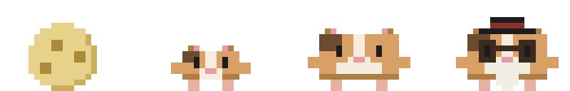 | **Porquinho-da-índia** 🐹 | Pelo tricolor (caramelo, mancha marrom e branco), orelhinhas redondas, nariz e pezinhos rosa | Não sai de ovo: começa num **ninho de feno** 🌾. **Wheek wheek!** quando ganha comida ou um prompt. Feliz, dá **pulinhos de alegria** (popcorning) no carinho. **Comilão:** a fome cai mais rápido, mas comer alegra bem mais. Espirra feno |
| 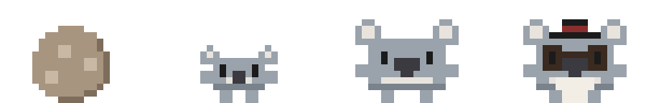 | **Coala** 🐨 | Cinza, orelhonas redondas e peludas, narizão escuro e queixo clarinho | Marsupial: começa **na bolsinha** 👜. **Dorminhoco:** cansa mais, cochila bem mais e dorme mais cedo. **Escalador:** sobe nas janelas bem mais vezes. **Gosta de colo:** pegar ele no mouse vira abraço (e alegra). Come eucalipto e espirra folhinha 🌿 |

<details>
<summary>Ver as poses de cada um</summary>
<p align="center">
  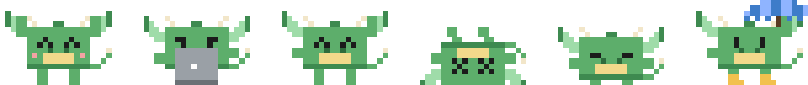<br>
  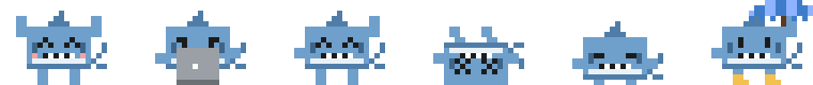<br>
  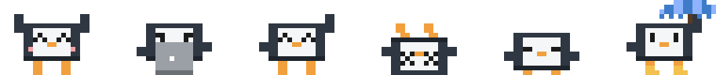<br>
  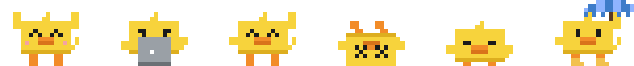<br>
  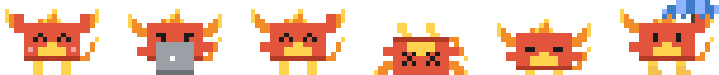<br>
  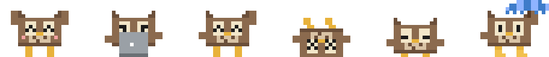<br>
  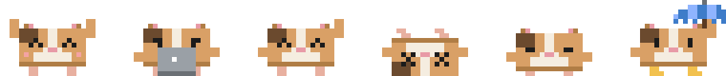<br>
  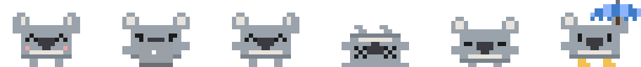
</p>
</details>

- Eles fazem **tudo** que o Clawd faz: necessidades, evolução (ovo → filhote → adulto → ancião de cartola,
  óculos e barba), roupas do clima, reações ao Claude Code, menu, física e tontura.
- **Cada pet tem o próprio progresso.** Da primeira vez o pet novo chega como ovo; o anterior fica guardado com
  o XP, a fase e as necessidades dele, **pausado**, e volta igualzinho quando você troca de novo.
- Clima, Claude Code, monitor e as opções do menu são os mesmos pra todos.
- Pra ver sem trocar: `python main.py --demo --pet coruja` (ou `dragao`, `tubarao`, `pinguim`, `pato`, `fenix`, `porquinho`, `coala`;
  dá pra juntar com `--fase`).
- Novos bichos entram em `pet/especies.py` (nome, fases e jeito) e `pet/pixelart.py` (pele, proporções e
  detalhes como asas e cauda); as poses e as roupas são reaproveitadas.

## 🌦 Clima

<p align="center">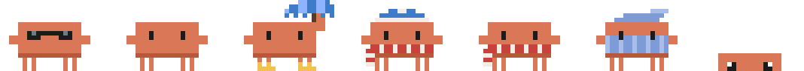</p>

Ele olha o céu da **cidade que você escolher** pelo [Open-Meteo](https://open-meteo.com/) (grátis, sem chave),
a cada 30 minutos, numa thread separada. Sem internet, continua com o último clima que conseguiu.

| Lá fora | O Clawd |
|---|---|
| ☀ Céu limpo (de dia) | Óculos escuros, e a felicidade sobe em vez de cair |
| 🥵 Acima de 30 °C | Um ventiladorzinho girando do lado dele |
| ☁ Nublado | Normal |
| 🌫 Neblina | Anda devagarinho |
| 🌧 Chuva ou garoa | Guarda-chuva e galochas; fica preguiçoso e cochila mais |
| ❄ Neve | Gorro e cachecol |
| ⛈ Trovoada | Se esconde atrás da barra de tarefas, tremendo: **"Tá trovejando! 😱"** |
| 🥶 Abaixo de 15 °C | Cachecol em qualquer tempo, e a fome cai mais rápido |
| 🌙 De noite | Pijama listrado com touca |

- **Previsão:** de manhã (entre 6h e 12h), uma vez por dia, ele avisa se vai chover mais tarde, olhando a
  chance de chuva hora a hora: *"☔ Previsão: deve chover lá pelas 14h (59%)"*.
- **Ver o tempo:** clique nele, ou menu → **Clima**, pra ver temperatura, sensação, vento e chance de chuva.
- **Escolher a cidade:** menu → **Clima e cidade** → Trocar cidade (ex.: `Recife, PE` ou `Curitiba`). Lá também
  dá pra forçar uma atualização.

## 🤖 Integração com o Claude Code

<p align="center">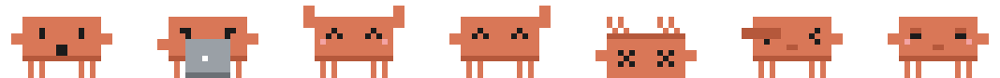</p>

| No Claude Code | O Clawd |
|---|---|
| Você manda um prompt | Come o prompt 🍤 e fica digitando concentrado até o Claude terminar |
| A task termina | Pula, toca um som, ganha XP e diz **"Terminei! Gastei X tokens"** |
| O Claude espera você (permissão, pergunta) | Acena sem parar com **"Preciso de você!"** até você voltar pro terminal |
| Um comando de teste passa | Comemora ✅ |
| Um comando de teste falha | Cai duro de costas 💀 |
| Um comando dá erro | Facepalm 🤦 |
| Você fica dias sem usar o Claude | Fica com fome e tristinho |
| Mudança parada há mais de 2 h sem commit | Levanta uma plaquinha **"commit?"** com o projeto e o tempo |

O **fiscal do git** olha só as pastas onde o Claude Code trabalhou nas últimas 12 h, a cada 10 minutos e
logo depois de cada task. Avisa quando tem mudança sem commit há mais de 2 h (ou mais de 300 linhas mudadas),
no máximo a cada 45 minutos por projeto, e nunca enquanto o Claude está trabalhando. Desliga em
menu → **Claude Code** → **Fiscal do git**.

Testes reconhecidos: pytest, unittest, npm/pnpm/yarn/bun test, jest, vitest, go/cargo/dotnet/mvn/gradle test,
make test/check, Invoke-Pester e outros. Se a saída disser "2 failed", conta como falha mesmo com código 0.

### Tokens

- **Sessão:** soma o `usage` de cada resposta no transcript da sessão, contando cada mensagem uma vez só.
- **Task:** quanto a sessão cresceu entre o prompt e o fim.
- **Semana:** todos os transcripts de `%USERPROFILE%\.claude\projects\` dos últimos 7 dias. Arquivos parados não
  são nem abertos, e só o que foi acrescentado é relido.
- **Meta semanal** (menu → Claude Code): a partir de 80% ele fica empanturrado e sonolento; acima de 100% pede
  pra você descansar.
- **Só input e output** (menu → Claude Code): o cache costuma ser quase tudo; com essa opção ele conta só
  entrada + saída. Cada modo tem a sua meta.

> [!NOTE]
> É o uso **deste PC** nos últimos 7 dias, calculado a partir dos transcripts locais. **Não é** o limite
> oficial do seu plano, que aparece no `/usage` do Claude Code.

### Como funciona por baixo

```powershell
python instalar_hooks.py            # instala/atualiza em %USERPROFILE%\.claude\settings.json
python instalar_hooks.py --remover  # tira só os hooks do Clawd
```

O instalador mantém o resto do `settings.json` (seus outros hooks inclusive) e guarda um backup em
`settings.json.bak-pet`. Os hooks (`UserPromptSubmit`, `Stop`, `Notification`, `PostToolUse` e
`PostToolUseFailure`) chamam `pythonw.exe hooks\pet_hook.py` direto, sem shell no meio, então funcionam em
qualquer pasta de projeto. Confira em `/hooks` dentro do Claude Code.

O script do hook grava em `%USERPROFILE%\.claude\`:

| Arquivo | Pra quê |
|---|---|
| `pet-eventos.jsonl` | Um evento por linha; o pet lê os novos a cada segundo |
| `pet-status.json` | O último evento, com os tokens da sessão |
| `pet-cache\` | Soma parcial de tokens de cada sessão (pra não reler o transcript inteiro) |
| `pet-hook-erros.log` | Se algo der errado; o hook nunca atrapalha o Claude Code |

Mudou a pasta do projeto ou o Python? Rode o instalador de novo (ou menu → Claude Code → Reinstalar hooks)
e recrie o atalho com `python criar_atalho.py`.

## 🎨 Sprites próprios

Enquanto não houver PNGs, o Clawd é desenhado em pixel direto no código (`pet/pixelart.py`). Pra trocar,
crie uma pasta por animação com os quadros em PNG de fundo transparente, virados pra direita:

```
sprites/
├── parado/        01.png 02.png ...      ← Clawd adulto
├── andando/   dormindo/   pendurado/   caindo/   comendo/   comemorando/
├── acenando/  escondido/  tonto/       espirrando/
├── digitando/ caido/      mao_na_cabeca/  empanturrado/  tremendo/
├── ovo/<animacao>/                       ← cada fase pode ter as suas (+ chocando/ no ovo)
├── filhote/<animacao>/
└── anciao/<animacao>/
```

- Os quadros tocam em ordem alfabética. Um `anim.json` opcional define a velocidade: `{"ms": 120}`.
- O tamanho é ajustado sozinho pra ~70 px de altura, com zoom inteiro (sem borrar).
- Use transparência total ou nenhuma, sem semitransparência, senão aparece um contorno escuro.
- Animação sem pasta continua com o desenho provisório.
- As roupas do clima são desenhadas por cima do provisório; com PNG próprio, ele fica sem elas.
- Outros pets usam o mesmo esquema dentro da pasta deles: `sprites/<bicho>/<fase>/<animacao>/` (ex.: `sprites/coruja/`).

O ícone e as imagens deste README saem da mesma pixel art: `python ferramentas/gerar_imagens.py`
(essa ferramenta precisa do Pillow: `pip install pillow`).

## 🧪 Testes

```powershell
python -m unittest discover -s tests -t .
```

São 299 testes: física, mouse, save, regras do tamagotchi, monitores, o script do hook rodando de verdade,
contagem de tokens, o menu, os pets, os lembretes (que entendem "amanhã 9h"), as datas especiais, a loja, o fiscal do git (com repositórios de mentira), a bola, as janelas (com janelas de mentira), o clima (com uma resposta real do Open-Meteo, sem acessar a rede) e as reações
do Clawd. Os que abrem janela usam uma pasta temporária no lugar do seu `~/.claude`.

## 🗂 Estrutura

<details>
<summary>Ver os arquivos</summary>

```
main.py               ponto de entrada (python main.py [--demo])
pet.pyw               abre sem terminal (é o que o atalho usa)
criar_atalho.py       cria o atalho com ícone na área de trabalho / Menu Iniciar
instalar_hooks.py     instala/remove os hooks no settings.json
hooks/
  pet_hook.py         o script que o Claude Code chama em cada evento
pet/
  mascote.py          janela, ações, mouse e loop de animação
  menu.py             menu do clique direito
  painel.py           janela de Status e tokens
  balao.py            balão de fala
  efeitos.py          coração, Zzz, migalhas, bolhas, gotas, estrelinhas e mosquinhas
  tamagotchi.py       avisos, sono, espirros, banho e XP
  necessidades.py     regras do tamagotchi: taxas, gripe, tempo offline, fases (sem Tk)
  clima.py            Open-Meteo, códigos de tempo, roupas e previsão (regras sem Tk)
  clima_controle.py   busca o clima numa thread, veste o pet e avisa da previsão
  claude_code.py      lê os eventos dos hooks, reações, meta e tokens da semana
  eventos_claude.py   traduz o JSON do hook em eventos do Clawd (sem Tk)
  tokens.py           soma de tokens dos transcripts (sem Tk)
  fisica.py           gravidade, arremesso e quiques (sem Tk)
  interacao.py        clique x arrasto, velocidade do arremesso, sacudida (sem Tk)
  sprites.py          carrega PNGs ou o desenho provisório
  pixelart.py         toda a pixel art: todos os bichos em cada fase, roupas, efeitos, ícones
  especies.py         os pets, o jeito de cada um e a troca entre eles (progresso separado)
  janelas.py          andar em cima das janelas: chão de cada janela, pulos, carona e quedas
  lembretes.py        entende o "quando" (amanhã 9h, daqui a 20 min...) e dispara os lembretes
  dialogo_lembrete.py janelinha de novo lembrete, com a prévia do horário
  datas.py            datas especiais e o seu aniversário (Páscoa e Carnaval calculados)
  hora_dormir.py      hora de dormir: bocejo, "vai dormir!" e soneca se você sair
  tela_cheia.py       some quando um programa abre em tela cheia
  fiscal_git.py       olha o git dos projetos do Claude Code e pede commit
  resumo.py           resumo do dia (tempo no PC, tasks, tokens, carinhos)
  musica.py           medidor de volume do Windows pelo ctypes, fone e dancinha
  loja.py             acessórios comprados com XP
  bola.py             a bola (janela própria com a física do pet) e o jogo de chutar
  estado.py           save em pet.json
  sons.py             sonzinhos com winsound
  tela.py             API do Windows: DPI, monitores, janelas abertas, tempo ocioso, janela em foco
  config.py           todos os números ajustáveis
assets/               ícone do programa
docs/                 imagens deste README
ferramentas/          gerador do ícone e das imagens
tests/
```

O save fica em `pet.json` e os erros em `pet.log`, ambos na pasta do projeto (fora do git).
</details>

## 🗺 Roadmap

- [x] **Fase 1:** janela transparente, andar, clique, menu, arrastar, arremessar e tontura
- [x] **Fase 2:** necessidades, tempo offline, avisos, gripe, banho e evolução
- [x] **Fase 3:** hooks do Claude Code, contador de tokens e meta semanal
- [x] **Fase 4:** clima de verdade (Open-Meteo), roupinhas pelo tempo e previsão
- [x] **Extra:** troca de pet: dragãozinho, tubarãozinho, pinguinzinho, patinho de borracha, fênix, corujinha,
  porquinho-da-índia e coala
- [x] **Extra:** andar em cima das janelas (pousar, pular, pegar carona)
- [x] **Extra:** brincar de bola e a Fênix anciã renascendo como ovo
- [x] **Fase 5:** lembretes, datas especiais, hora de dormir, tela cheia, fiscal do git, resumo do dia, música e loja
- [ ] **Depois:** conversar com o pet pela API do Claude (duplo clique)

<div align="center">
<sub>Feito com 🧡 e muitos tokens. Clawd é o mascote do <a href="https://claude.com/claude-code">Claude Code</a>.</sub>
</div>
